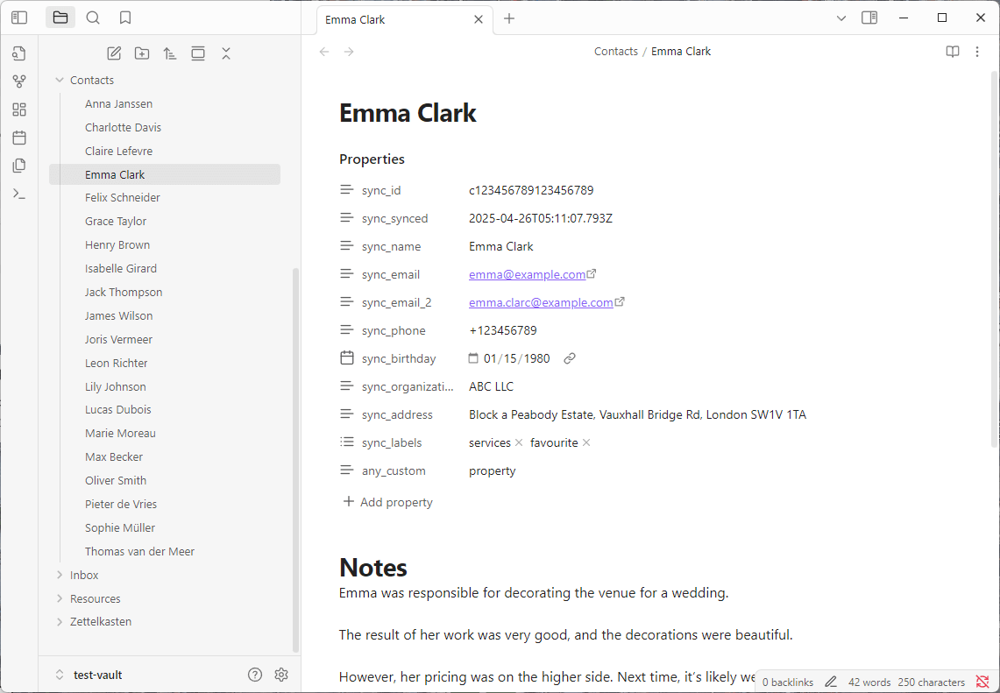
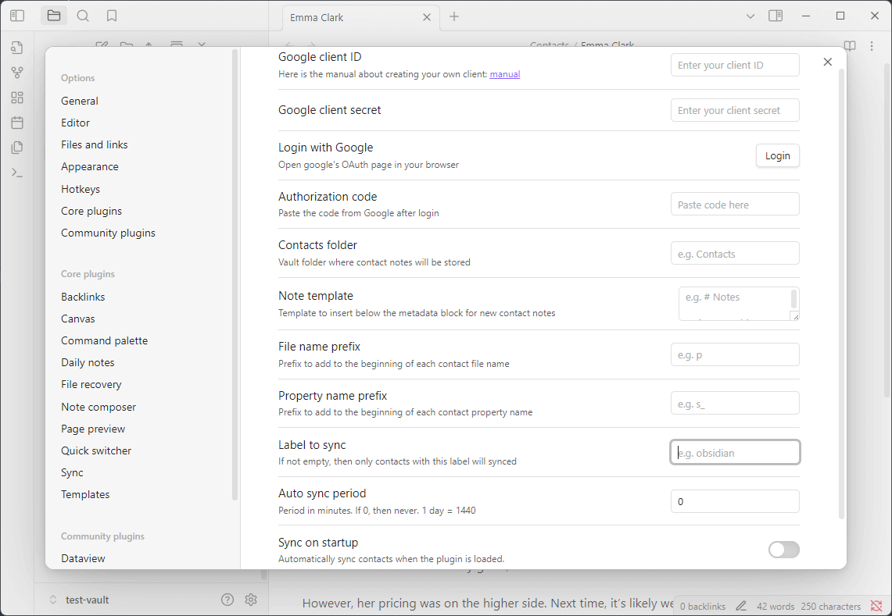

# 🧩 Google Contacts Sync

Synchronize your Google contacts directly into Obsidian!  
Each contact becomes a separate note with YAML frontmatter for metadata and free-form text for your notes.

---

## ⚙️ Features

- 🔄 Synchronize Google contacts into your Obsidian vault

- 🔍 Audit contacts to find local notes that no longer exist in Google Contacts

- 🗂 Configurable folder for storing contact notes

- ✏️ Customizable note template (under the metadata block)

- 🏷 Filter by Google contact label (e.g. only sync contacts tagged with `obsidian`)

- 📛 Filename prefix support (e.g. `p Ivan Ivanov.md`)

- 🏷️ Customizable naming strategy for filenames as last name first (e.g. `p Ivanov Ivan.md`)

- 🧩 Multiple naming strategies for frontmatter keys:
    - **Default**: Customizable prefix (e.g., `s_name`, `s_email_2`).
    - **VCF (vCard)**: Fully compatible with the [VCF Contacts](https://github.com/broekema41/obsidian-vcf-contacts) plugin.
    - **Array**: Stores multiple values (emails, phones, etc.) as a single array field in the frontmatter.

- 📇 Supports multiple names, emails, phone numbers, birthdays, addresses, organizations, job titles, department, labels, relations


- 🏷️ Option to sync Relations as Obsidian links (e.g. `[[Jane Doe|Jane Doe (spouse)]]`)

## 📸 Screenshots




---

## 📦 Installing into Obsidian

1. Open your Obsidian vault

2. Go to Settings → Community plugins

3. Turn Safe mode → OFF

4. Click Browse and search for `Google Contacts`

5. Click Install, then Enable the plugin

## 🔐 Google Authorization

1. Go to the plugin settings inside Obsidian.

2. Fill in:

- Client ID

- Client Secret
(see instructions below for how to obtain these)

3. Click the "Login to Google" button.

4. Follow the link, log in with your Google account, and copy the authorization code.

5. Paste the code into the prompt in Obsidian.
The plugin will automatically save the access and refresh tokens.

## 🚀 How to Use

1. Open the command palette (Ctrl+P or Cmd+P)

2. Run the command: Google Contacts: Sync

3. Run the command: Google Contacts: Audit Contacts


## 🔁 Sync Algorithm

- Only notes within the specified folder are used for syncing contacts.
    
- Each contact is matched using its `id` stored in the YAML frontmatter.
    
- If a contact already exists (by `id`), the plugin updates only the frontmatter. Existing user-defined frontmatter properties and free-text content below the frontmatter are preserved and **never overwritten**.

- There's an option to change the note title if a contact's name changes. Links in notes will automatically update if this option is enabled in the settings.
    
- How field names are generated depends on the selected **Naming Strategy**:

#### Default Strategy
The plugin appends a number starting from 2 for additional pieces of information:
```yaml
phone: +123456789
phone_2: +987654321
```

You can also define a **prefix** for the property names. For example, if the prefix is `sync_`, the properties will be stored as:

```yaml
sync_id: CONTACT_ID
sync_name: Full Name
sync_email: email@example.com
sync_phone: +123456789
sync_synced: 2025-04-19T12:34:56.789Z
```

#### VCF (vCard) Strategy
Designed for full compatibility with the [VCF Contacts](https://github.com/broekema41/obsidian-vcf-contacts) plugin. It uses standard vCard field names and indexed notation for multiple values:

```yaml
FN: Full Name
TEL: +123456789
TEL[2]: +987654321
EMAIL: email@example.com
ADR.CITY: New York
CATEGORIES: Friends, Work
```

> [!IMPORTANT]
> To ensure strict vCard compatibility, the following settings are **ignored** when the VCF strategy is active:
> - **Property name prefix** (keys always use standard vCard names).
> - **Organization as link** (organizations stored as plain text).
> - **Relations as link** (relations stored as plain text).
> - **Track last sync time** (no `synced` field added).

- If no matching file exists, a new note is created with the following structure:
    
```yaml
---
id: CONTACT_ID
name: Full Name
email: email@example.com
phone: +123456789
synced: 2025-04-19T12:34:56.789Z
---

# Notes  

You can write anything here — this section is safe.
```

- The `synced` date uses **UTC (Coordinated Universal Time)** to ensure correct synchronization across time zones. This option is disabled by default to improve performance and avoid touching hundreds of contact notes with each synchronization.
    
- The plugin only updates properties related to the contact (such as `name`, `email`, `phone`, etc.). Any custom properties created by the user will **remain untouched**.
    
- **Contact notes in the note body** (optional, off by default): enable *Sync contact notes to note body* to write the Google Contacts **Notes** field into a managed section of the note instead of the `bio` frontmatter property:

```md
<!-- google-contacts:notes:start -->
Notes from Google Contacts
<!-- google-contacts:notes:end sync=1x2y3z -->
```

  The `sync=…` value is a short hash of the last synced text. It is used to tell which side changed when sending notes back to Google is enabled. Don't edit the marker lines.

  The section is added to the end of the note the first time a contact has notes. On every sync only the text between the markers is replaced. Everything outside them stays as you wrote it. While this option is on, the plugin removes the `bio` (or `NOTE` in VCF) property it wrote before, so the notes are not stored twice. Edits made inside the section are overwritten by the next sync, unless write-back (below) is enabled.

- **Sending notes back to Google** (optional, experimental, off by default): with *Send note edits back to Google Contacts* enabled, edits you make inside the notes section are sent to the contact's **Notes** field in Google during sync.
    - Requires full access to your contacts (`https://www.googleapis.com/auth/contacts` scope). After enabling the option, click **Login** again in the plugin settings and paste the new code. If you use your own OAuth client, add this scope to its consent screen. Until you log in again, notes are only read from Google.
    - Every contact note gets a notes section (empty if the contact has no notes yet), so you have a place to write.
    - If only Google changed, the note is updated. If only the note changed, Google is updated. If **both** changed, nothing is changed on either side and you get a notification. Make the text match on one side to resolve it.
    - If more than 5 notes are about to be sent in one sync, you are asked to confirm and shown the list of contacts. This protects your address book from scripts or bulk edits in the vault.
    - Only "My contacts" can be updated. "Other contacts" are read-only in Google. Notes with formatting (HTML) are read-only too, because a plain-text update would remove the formatting.
    - If one of the marker lines is deleted or duplicated, that note is left untouched and you get a notification. Restore both marker lines, or delete both to let the plugin recreate the section.
    - Only the Notes field is ever written to Google. All other fields stay read-only.

- If auto-syncing fails (e.g., due to a lack of internet connection), the next attempt will only occur during the next scheduled auto-sync. **No retries will be attempted** in between.

- If a sync label is configured, only contacts with that label will be synchronized. Contacts without the specified label will be ignored during the sync process.

## 🔍 Contact Audit

The plugin provides a command to audit your local contact notes against your Google Contacts.

- **Goal**: Identify contact notes in your vault that do not exist (or no longer match the sync label) in Google Contacts.
- **How to run**: Open command palette and search for `Google Contacts: Audit Contacts`.
- **Output**: Generates a report file `Contact Audit Report.md` in your vault root.
  - If functioning correctly, it will list "No orphaned contacts found".
  - If orphans are found, it lists the files and their contact IDs so you can decide whether to delete or keep them.

## 🔐 How to Get a Google Client ID and Secret
To sync your contacts, you’ll need a valid Google Access Token that grants access to the People API. Follow the steps below to obtain the **Client ID** and **Client Secret**, and to configure your account so you can retrieve the necessary **Authorization Code** for the Obsidian plugin.

### 1. Set up Google Cloud

Go to [Google Cloud Platform](https://console.cloud.google.com) 

Create a new project (or select an existing one)

### 2. Enable People API

Navigate to: **API & Services → Library**

Search for **Google People API**

Click **Enable**

### 3. Configure the OAuth Consent Screen

Navigate to: **API & Services → OAuth consent screen**

Navigate to: **Audience** tab

If prompted, click **Get started**

Fill in the required App information (App name, User support email)

Set the User Type to **External** (you do not need to publish the app)

Complete the contact information and click **Finish**

### 4. Add Your Account as a Test User

Navigate to: **Audience** tab again
 
Go to the **Test users** section (under the "OAuth user cap")

Click **"+ Add users"** and enter the **exact Google email address** you will use to log in from within Obsidian

### 5. Create OAuth 2.0 Credentials

Go to: **API & Services → Credentials**

Click **"+ Create Credentials"** and select **"OAuth client ID"** from the list

For Application type, select: **Desktop App**, and give it a name

Copy your **Client ID** and **Client Secret** and insert them into the plugin's options

### 6. Get the Authorization Code

In the Obsidian plugin, **log in** with the registered Test User email via the **"Login"** button

After confirming the dialog to grant the plugin permissions, a final screen will display the **Authorization Code** you need to copy and paste back into the plugin

## 🔧 Build Instructions

To build the plugin:

1. Clone or download the repository

2. Install dependencies:

   ```bash
   npm install
   ```

3. Build the plugin using Rollup:   

   ```bash
   npm run build
   ```

### 📦 Installing your build into Obsidian

1. Open your Obsidian vault

2. Go to .obsidian/plugins/ and create a folder, e.g. google-contacts-sync

3. Copy the following files into that folder:

```
google-contacts-sync/
├── main.js
└── manifest.json
```

4. In Obsidian:

- Go to Settings → Community Plugins

- Enable Safe Mode → OFF

- Click "Load community plugins"

- Enable google-contacts-sync
